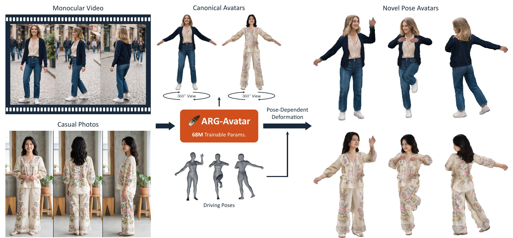
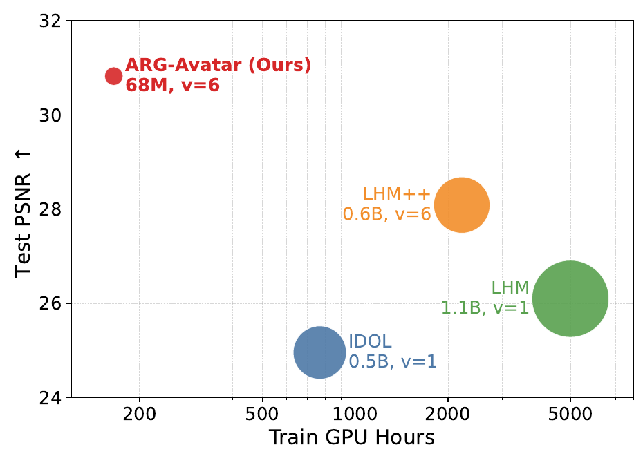
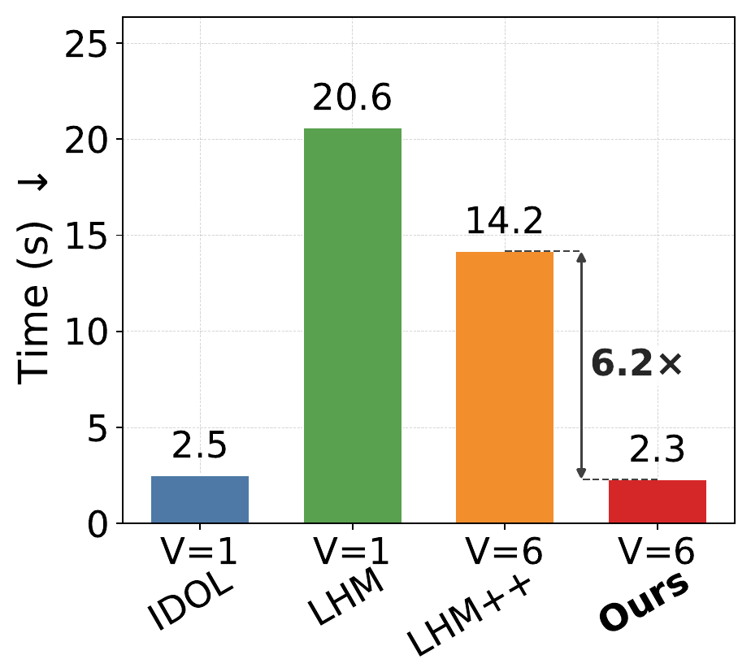
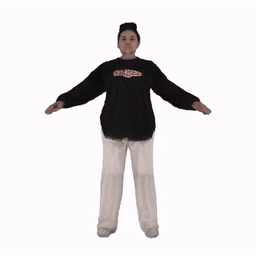
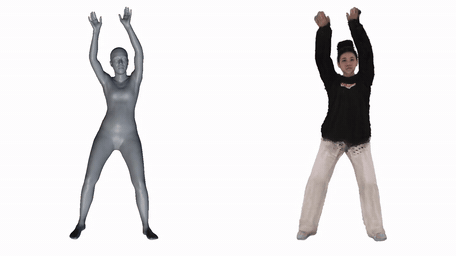
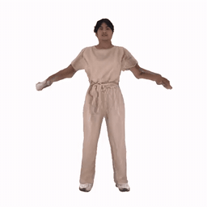
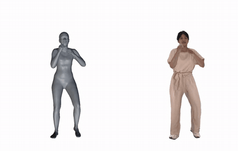
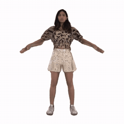
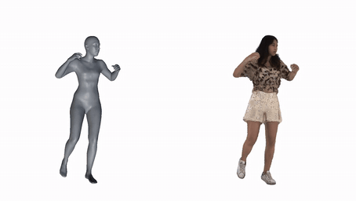
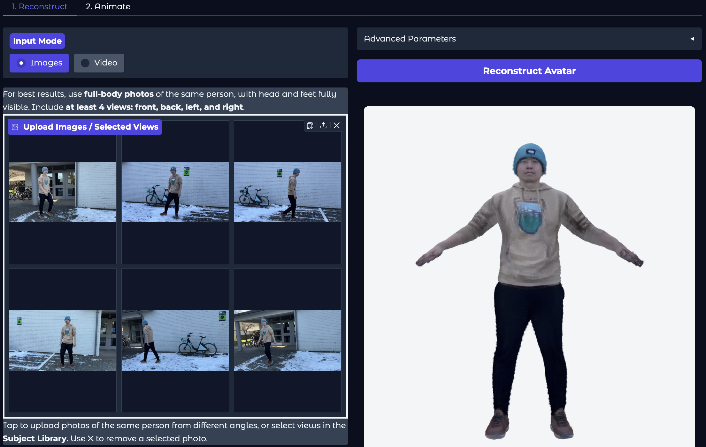

# ARG-Avatar

**ARG-Avatar: Animation-Rendering Guidance for Efficient Feedforward Avatar Reconstruction**

[Jianjin Xu](https://atlantixjj.github.io/)<sup>1</sup>&nbsp;&nbsp;
[Soham Dasgupta](https://scholar.google.com/citations?user=ApBwadEAAAAJ&hl=en)<sup>1</sup>&nbsp;&nbsp;
[Fernando De la Torre](https://www.cmu.edu/cs/humansensing/pages/home.htm)<sup>1</sup>

<sup>1</sup>Carnegie Mellon University &nbsp;&nbsp;

[](#)
[](https://atlantixjj.github.io/ARG-Avatar/)

<!-- TODO: update the arXiv link once public, and update §4 Citation. -->

ARG-Avatar reconstructs animatable 3D Gaussian avatars from several casual photos or frames of a monocular video, in a single feed-forward pass.
It consists of merely 68M trainable parameters and is trained with public data only, yet surpasses baselines trained with 10x more training compute.




<p align="center">
  
  &nbsp;&nbsp;
  
</p>

**Left:** NeuMan benchmark (never seen in training) novel-pose PSNR against training compute.
**Right:** feed-forward reconstruction time on RTX A6000.

## Gallery

Each avatar is reconstructed from six images in one feed-forward pass. Left: the canonical avatar, turned through
360°. Right: the same avatar driven by a dance loop from `assets/example_motion/`, next to the driving MHR body.

<table>
  <tr><th>Canonical avatar (360°)</th><th>Driving pose → animated avatar</th></tr>
  <tr>
    <td align="center"></td>
    <td align="center"></td>
  </tr>
  <tr>
    <td align="center"></td>
    <td align="center"></td>
  </tr>
  <tr>
    <td align="center"></td>
    <td align="center"></td>
  </tr>
</table>

**Released components:**

- [x] Pretrained model ([weights on Hugging Face](https://huggingface.co/atlantix/ARGAvatar))
- [x] Gradio demo
- [x] Inference scripts
- [x] Benchmark

**We don't have plan to release**:
- Training code
- Data preprocessing

## Contents

1. [Quick start](#1-quick-start): [install](#11-install), [run the example](#12-run-the-example),
   [use your data](#13-use-your-data), [web demo](#14-web-demo),
   [motion from a video](#15-motion-from-your-own-video)
2. [Evaluation](#2-evaluation): [benchmark data](#21-benchmark-data), [run](#22-run-the-benchmark),
   [expected results](#23-expected-results)
3. [Runtime and memory](#3-runtime-and-memory)
4. [Citation](#4-citation)
5. [Acknowledgements](#5-acknowledgements)

---

## 1. Quick start

`<ANGLE_BRACKETS>` mark values you choose. Run every command from the repository root **with `PYTHONPATH` empty**
(`PYTHONPATH= python ...`), so that the `xlib` package resolves to this checkout. The examples below leave out the
prefix for brevity.

### 1.1 Install

```bash
git clone https://github.com/AtlantixJJ/ARG-Avatar.git
cd ARG-Avatar
hf auth login                            # after accepting the terms of the two gated repos (below)
bash scripts/download_weights.sh         # ~6 GB; needs huggingface_hub (python -m pip install huggingface_hub)
bash scripts/install_argavatar_env.sh    # one conda env `argavatar`; builds the CUDA extensions
conda activate argavatar
```

Before logging in, accept the terms of the gated
[`facebook/sam-3d-body-dinov3`](https://huggingface.co/facebook/sam-3d-body-dinov3) and
[`facebook/dinov3-convnext-tiny-pretrain-lvd1689m`](https://huggingface.co/facebook/dinov3-convnext-tiny-pretrain-lvd1689m)
repos in a browser. Download the weights first: the installer finishes by loading the checkpoint to check it. Both
scripts are idempotent and skip what is already in place.

The installer uses Python 3.12 and PyTorch 2.5.1 with CUDA 12.1. A CUDA toolkit
(`nvcc`) and a C++ compiler are required to build the extensions. It installs
PyTorch first, then everything in `requirements.txt` with `--no-build-isolation`
so the extensions build against the installed PyTorch. To install into an
existing Python 3.12 environment, run from the repository root:

```bash
python -m pip install --extra-index-url https://download.pytorch.org/whl/cu121 \
    torch==2.5.1+cu121 torchvision==0.20.1+cu121 "setuptools<81" wheel ninja
python -m pip install --no-build-isolation -r requirements.txt
```

`--env <NAME>` selects another Conda environment; `--no-verify` skips
the final checkpoint checks when weights have not been downloaded yet. MHR comes
from PyPI; nvdiffrast, Detectron2 and MoGe still use pinned GitHub sources because
they have no compatible package releases.

<details markdown="1">
<summary>Weights details</summary>

`download_weights.sh` fetches:

| what | where |
|---|---|
| ARG-Avatar checkpoint (~260 MB) | `checkpoints/ARGAvatar-Final.pth` |
| SAM 3D Body (2.7 GB) | `pretrained_models/sam-3d-body-dinov3/` |
| DINOv3 ConvNeXt config | `pretrained_models/` |
| pinned DINOv3 source | `pretrained_models/dinov3-<revision>/` |
| SAM 2 checkpoint (857 MB) | `thirdparty/sam2/checkpoints/` |

* `--skip-sam2`, `--skip-sam3dbody` and `--skip-dinov3` leave items out.
* The pinned DINOv3 source comes from `scripts/download_runtime_assets.py`, which the script calls; model
  construction never downloads Torch Hub code.
* `ARGAVATAR_WEIGHTS_HF_REPO=<REPO>` (a Hugging Face model repo) or `ARGAVATAR_WEIGHTS_URL=<URL>` (a plain base URL)
  fetch our checkpoint from elsewhere.
* The script also hardlinks the checkpoint to `expr/ARGAvatar-Final/PT_<step>.pth`, where the evaluation harness looks up a
  bare model name; the commands in this README pass `--checkpoint_path` instead.
* Two more models download themselves from public, ungated sources the first time you run on your own images, so that
  first run needs network access: the ViTDet person detector (`model_final_f05665.pkl`, ~2.4 GB, via detectron2) and
  the MoGe-2 field-of-view estimator (`Ruicheng/moge-2-vitl-normal`, from Hugging Face).

</details>

### 1.2 Run the example

```bash
python scripts/inference/infer_argavatar.py --images assets/example_images/dnarendering/542_00004 \
  --name dnarendering_542_00004
```

This reconstructs the bundled DNA-Rendering subject from its six views and writes to
`expr/inference/dnarendering_542_00004/`:

```
render/                      the 6 input views re-rendered from their own cameras
render_human_input/          the 6 inputs as the model sees them (cropped and masked)
canonical_render_a000.png    8 stills of the canonical rest pose, every 45° (… a045 … a315)
orbit.mp4                    360° turntable, 90 frames
```

### 1.3 Use your data

Data requirements:

* One person per image, and all images of one subject must show the same person.
* Full-body shots work best: casual photos, or frames picked from a phone video.
* Views from different sides help most. A front plus a back view is a large improvement over a single front view; the
  model is not trained to inpaint unseen regions, so single-view results are weaker on the hidden side.

```bash
python scripts/inference/infer_argavatar.py --images <IMG_1.png> <IMG_2.png> ...   # one subject: files, a folder or a "glob/*.png"
python scripts/inference/infer_argavatar.py --input_dir <SUBJECTS>                 # many subjects, one subfolder each
```

To animate the avatar and export its Gaussians, for example:

```bash
python scripts/inference/infer_argavatar.py --images assets/example_images/neuman/bike_0 \
  --motion assets/example_motion/woman_dance_2_loop01.pth --save_ply --ply_frame 14
```

| option | default | meaning |
|---|---|---|
| `--motion` | none | one or more motion files (`<MOTION.pth>`); writes `<motion>_crop.mp4` (around the body) and `<motion>_original.mp4` (source camera) under `motion/` |
| `--save_ply` | off | save the canonical Gaussians as `canonical.ply` |
| `--ply_frame` | none | with `--motion`: also save frame *N* of each motion as a posed `.ply` |
| `--ply_format` | `3dgs` | `3dgs`: the standard layout SuperSplat and most viewers open; `spark`: a compact 14-float layout |
| `--save_avatar` | off | save the canonical Gaussians and pose as `avatar_<model>_<ckpt>.pth` |
| `--max_views`, `--min_views` | 6, 1 | cap on views per subject; skip subjects with fewer usable detections |
| `--no_orbit` | off | skip the turntable video |
| `--driving_format` | `video` | `images` writes one PNG per animation frame instead |
| `--output_folder`, `--name` | `expr/inference/`, the first image's name | where results go |

`--driving_mhr_pose` is accepted as another name for `--motion`; `--help` lists every option.

### 1.4 Web demo

```bash
python -m app            # --share for a public gradio.live link
```

Two tabs: **Reconstruct** (upload images, orbit the avatar in an interactive 3D viewer, download a `.ply`) and
**Animate** (drive the avatar with a bundled motion, or upload a video to fit a new one; the animation streams into the
browser while it renders). The model loads once at startup, in about a minute. The demo also works on phones.



<details markdown="1">
<summary>Server options and behaviour</summary>

| option | default | meaning |
|---|---|---|
| `--server_name`, `--server_port` | `127.0.0.1`, `7860` | bind address and port |
| `--share` | off | public `gradio.live` link |
| `--checkpoint_path`, `--config` | the release model | another model |
| `--max_render_height` | 1024 | cap on animation frame height, source framing kept; `0` = full source resolution |
| `--motion_chunk_frames` | 15 | frames per streamed H.264 chunk; smaller starts playback sooner |
| `--export_motion_3d` | off | also write the posed Gaussians of every frame as numbered `.ply` files plus a `manifest.json` (frame order, FPS) to `motion/gaussian-sequence-*/`; keeps root translation, costs disk and CPU |

* The complete animation is saved as an MP4 under `expr/app/<session>/motion/`. Python callers can pass
  `export_3d=True` / `False` to `render_motion`, `stream_motion` or `stream_motion_video` for one call.
* Each upload and generated file is visible only to the browser that created it (an HttpOnly cookie); bundled
  examples are public. Reconstruction and animation share one GPU queue. Uploads are limited to 20 MB per file.

</details>

### 1.5 Motion from your own video

```bash
python scripts/inference/estimate_motion_mhr.py --video <NAME> --video_path <VIDEO.mp4>
```

Fits per-frame MHR body poses and cameras to a video of one person and writes `expr/motion_pose/<NAME>/sam3db_s0.pth`,
ready for `infer_argavatar.py --motion` or the demo's Animate tab. Try it with
`assets/example_videos/dnarendering_0012_09_cam52.mp4`.

| `--strategy` | what it does | needs `kaolin` |
|---|---|---|
| `s0` (default) | raw per-frame poses | no |
| `s1` | + a shared median body shape | no |
| `s2` | + One-Euro filtering | no |
| `s3` | + windowed temporal optimisation | yes |
| `s4` | all of the above | yes |

`kaolin` is installed from NVIDIA's official wheel index by `requirements.txt`. The fit runs in six stages (track, confidence, gating,
subsampling, reference avatar, strategy); `--stage` reruns one to resume a partial fit. Motion files are
`sam3db`-format dicts, `{"images/<frame>.png": {pose + camera}}`.

---

## 2. Evaluation

Only this section needs a dataset. The benchmark is [NeuMan](https://github.com/apple/ml-neuman), which is never used in training.

### 2.1 Benchmark data

```bash
python scripts/download_evaluation/prepare_neuman.py --all
```

NeuMan's frames belong to Apple and are not redistributed here. `--all` downloads them from Apple and combines them
with our detection pack (~4 MB, shipped in `assets/benchmark/`: refined masks, SAM 3D Body / MHR poses, scene cameras,
the validation split). Each step can also run on its own if one fails partway:

| step | what it does |
|---|---|
| `--download` | fetch Apple's `dataset.zip` (~2.1 GB) into `data/neuman_raw/` |
| `--unzip` | unpack it and copy the frames into the benchmark root |
| `--detections` | check the pack's SHA256, unpack it over the root, derive `input_images/` and `input_masks/` |
| `--verify` | check that every frame of the validation list is present, masked and covered by `sam3db.pth` |

The benchmark lands in `data/AnimatableHuman/Rendering/NeuMan`, the exact path the validation list pins. To keep the
data elsewhere, symlink it there instead of passing `--root`:

```bash
mkdir -p data/AnimatableHuman/Rendering && ln -s <YOUR_COPY> data/AnimatableHuman/Rendering/NeuMan
```

`--verify` works on any existing copy and names what is missing and which step supplies it.

<details markdown="1">
<summary>Other sources for the detection pack</summary>

* `ARGAVATAR_DATA_URL=<URL>`, `ARGAVATAR_DATA_HF_REPO=<REPO>` or `--detections_archive <PATH>` replace the bundled
  pack.
* `prepare_neuman.py --from_scratch` estimates new masks and poses with
  `scripts/download_evaluation/generate_neuman_masks.py` and `scripts/download_evaluation/generate_neuman_poses.py`.
  The result is close, but does not reproduce the published metrics exactly.
* Maintainers rebuild the bundled pack with `python scripts/release/build_release_packs.py --out_dir assets/benchmark`.

</details>

### 2.2 Run the benchmark

```bash
python evaluation/argavatar/eval_argavatar.py \
  --config configs/ARGAvatar-Final.yaml \
  --checkpoint_path checkpoints/ARGAvatar-Final.pth \
  --data_config configs/_shared/data_val_list.yaml \
  --eval_views 1 2 3 4 6
```

Each view count *N* writes `expr/results/ARGAvatar-Final/<ckpt>_n<N>/eval_results.json`; its `overall` block is the
sample-weighted mean in [2.3](#23-expected-results). Every cell is recomputed by default. Do **not** pass `--skip_existing` when
numbers must be comparable: it reuses results already on disk.
`python evaluation/scripts/collect_eval_results.py` merges `expr/results/` into `expr/download/*.json`. Harness
details: [`evaluation/README.md`](evaluation/README.md).

### 2.3 Expected Results

| N | PSNR ↑ | SSIM ↑ | LPIPS ↓ |
|---:|---:|---:|---:|
| 1 | 27.02 | 0.9664 | 0.0237 |
| 2 | 29.17 | 0.9708 | 0.0190 |
| 3 | 29.78 | 0.9723 | 0.0175 |
| 4 | 30.14 | 0.9731 | 0.0170 |
| 6 | 30.82 | 0.9747 | 0.0159 |

---

## 3. Runtime and memory

The runtime profile on A6000 is as follows (includes SAM 3D Body):

| views | reconstruction | animation | peak VRAM |
|---:|---:|---:|---:|
| 1 | 1.8 s | ~80 FPS | 7.7 GB |
| 2 | 1.8 s | ~80 FPS | 7.7 GB |
| 3 | 1.9 s | ~80 FPS | 8.0 GB |
| 4 | 1.9 s | ~80 FPS | 8.4 GB |
| 6 | 2.3 s | ~80 FPS | 9.1 GB |

In-the-wild inputs require person detection, segmentation and FOV estimation which is not part of the profiling.

---

## 4. Citation

If you find this work useful, please cite:
```bibtex
@misc{xu2026argavatar,
  title  = {{ARG-Avatar}: Animation-Rendering Guidance for Efficient Feedforward Avatar Reconstruction},
  author = {Xu, Jianjin and Dasgupta, Soham and De la Torre, Fernando},
  year   = {2026}
}
```

## 5. Acknowledgements

We thank the contribution and generous open-sourcing of many existing works and codebases:

- [SAM 3D Body](https://github.com/facebookresearch/sam-3d-body)
- [MHR](https://github.com/facebookresearch/MHR)
- [DINOv3](https://github.com/facebookresearch/dinov3)
- [SAM 2](https://github.com/facebookresearch/sam2)
- [3D Gaussian Splatting](https://github.com/graphdeco-inria/gaussian-splatting)
- [nvdiffrast](https://github.com/NVlabs/nvdiffrast)
- [detectron2](https://github.com/facebookresearch/detectron2)
- [MoGe](https://github.com/microsoft/MoGe)
- [Spark](https://sparkjs.dev)
- [NeuMan](https://github.com/apple/ml-neuman)
